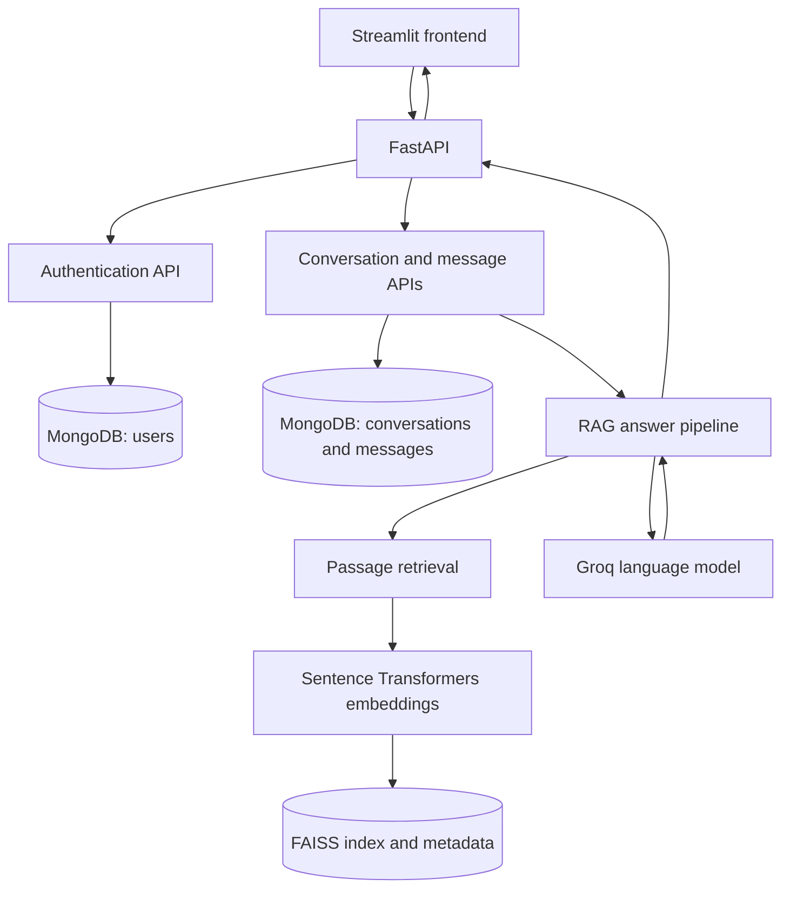

# VedaVerse AI

VedaVerse AI is a scripture-focused question-answering application. A Streamlit interface sends requests to a FastAPI service, which uses the project's retrieval-augmented generation (RAG) pipeline to find Bhagavad Gita passages and generate an answer. FastAPI stores user accounts, conversations, and messages in MongoDB.

> Dataset files, the source PDF, and the generated FAISS index are not included in this repository. See [Build the local scripture index](#build-the-local-scripture-index) before using question answering on a fresh checkout.

## Features

- Ask questions about the Bhagavad Gita through a Streamlit chat interface.
- Retrieve related scripture passages with Sentence Transformers and FAISS.
- Generate answers with Groq and display the associated references and verse details.
- Register and log in with username or email; password hashes use Argon2id and sessions use JWT access tokens.
- Persist conversations and message history in MongoDB.
- View translation, purport, and complete verse details in the chat.
- Switch between light and dark themes.

## Architecture



The frontend calls FastAPI through `frontend/api_client.py`; it does not import RAG modules. Authentication and conversation storage use MongoDB. For a submitted conversation message, FastAPI records the user's message, calls the RAG pipeline, then stores and returns the assistant's answer and reference data.

## RAG pipeline

1. Extraction utilities turn a locally supplied Bhagavad Gita PDF into text and structured verse data.
2. `rag/prepare_dataset.py` builds a cleaned search dataset and a complete-verse dataset.
3. `rag/ingest.py` encodes search passages with the `all-MiniLM-L6-v2` Sentence Transformers model, normalizes the vectors, and writes a FAISS index plus metadata under `vectorstore/`.
4. `rag/retrieve.py` finds relevant passages with **hybrid retrieval** (below). A question that names a verse, such as "Explain 2.47", is looked up directly instead. `rag/rag.py` uses the retrieved context to generate an answer through Groq and prepares the response references and verse details.
5. The FastAPI message route answers repeated questions from the **FAQ answer cache** (below) and stores the user and assistant messages in MongoDB.

The RAG code includes citation validation against retrieved passages and an insufficient-context response path.

### Hybrid retrieval

Two retrievers rank the indexed passages, and Reciprocal Rank Fusion merges their rankings (`RRF_K = 20` in `rag/retrieve.py`):

- **Semantic search:** FAISS over MiniLM embeddings finds passages with the same meaning in different words, for example "Should I quit my job and become a monk?".
- **Keyword search:** BM25 in `rag/keyword_search.py` finds exact terms, including Sanskrit words and names the embedding model handles poorly, such as *sthita-prajña*, *brahma-bhūta* and *man-manā*. It ignores diacritics, so "Krishna", "Krsna" and "Kṛṣṇa" all match.

`python scripts/eval_retrieval.py` measures recall@8 and MRR on 33 questions whose answer verses are well known. On that set, semantic search alone scores 87.9% recall, keyword search 90.9%, and hybrid 100%. The two retrievers fail on different questions, which is why fusing them helps. The set is small and hand-written, so treat these figures as a regression check rather than a benchmark.

### FAQ answer cache

`backend/app/services/answer_cache_service.py` stores complete, verified answers in the MongoDB `answer_cache` collection and serves repeated questions without calling retrieval or the LLM:

- **Exact repeats** match on case- and punctuation-insensitive text.
- **Paraphrases** match when their embedding similarity is at least `ANSWER_CACHE_SIMILARITY` (0.92). Questions that mention different numbers never match, so "Explain 2.47" never reuses 2.48. Requests for a detailed answer are cached separately from concise ones.
- **Not cached:** answers with insufficient context or no references.
- **Expiry and versioning:** entries expire after `ANSWER_CACHE_TTL_DAYS`. `CACHE_VERSION` in the service invalidates every entry when retrieval or generation changes.
- **Popular questions:** hit counts and distinct-asker counts record which questions are asked most. `GET /api/questions/popular` lists questions that at least three different people have asked, and the chat welcome screen suggests them.

The 0.92 threshold is deliberately strict. With this embedding model, some different questions score up to about 0.90, for example "What happens after death?" against "What happens at the time of death?".

## Technology

- Python
- Streamlit 1.37.1
- FastAPI and Uvicorn
- MongoDB with PyMongo's async client
- JWT access tokens with PyJWT
- Argon2id password hashing through `pwdlib`
- FAISS CPU
- Sentence Transformers
- Groq Python client

## Project structure

```text
VedaVerse AI/
├── backend/
│   ├── app/                 # FastAPI routes, services, schemas, and MongoDB access
│   ├── .env.example
│   └── requirements.txt
├── frontend/
│   ├── app.py               # Streamlit entry point
│   ├── api_client.py        # FastAPI client
│   └── ui/                  # Authentication, chat, sidebar, references, styles
├── rag/                     # Retrieval, answer generation, ingestion, data preparation
├── scripts/extraction/     # PDF and text extraction utilities
├── data/                    # Local source and generated datasets (not committed)
├── vectorstore/             # Generated FAISS index and metadata (not committed)
├── .env.example
├── .gitignore
└── README.md
```

## Authentication and persistence

Registration stores an Argon2id password hash rather than the submitted password. Login returns a JWT access token; protected API requests send it as a Bearer token. User, conversation, and message records are stored in MongoDB. Conversation and message endpoints scope reads and writes to the authenticated user.

## API overview

FastAPI's interactive API documentation is available at `/docs` while the backend is running.

| Method | Path | Purpose |
|---|---|---|
| `GET` | `/api/health` | Backend and MongoDB readiness |
| `POST` | `/api/auth/register` | Register an account |
| `POST` | `/api/auth/login` | Obtain a JWT access token |
| `GET` | `/api/auth/me` | Get the authenticated user |
| `GET`, `POST` | `/api/conversations` | List or create conversations |
| `GET`, `DELETE` | `/api/conversations/{conversation_id}` | Read or delete a conversation |
| `GET`, `POST` | `/api/conversations/{conversation_id}/messages` | Read history or submit a question |
| `GET` | `/api/questions/popular` | Most frequently asked questions (from the answer cache) |
| `POST` | `/api/chat` | Generate a chat response through the RAG pipeline |

## Local setup

### 1. Install Python dependencies

Use Python 3.10 or newer. From the project root, create and activate a virtual environment, then install the backend/RAG dependencies and the pinned Streamlit frontend dependency:

```powershell
py -3.11 -m venv .venv
.\.venv\Scripts\Activate.ps1
python -m pip install --upgrade pip
pip install -r backend/requirements.txt
pip install streamlit==1.37.1
```

On macOS or Linux, activate with `source .venv/bin/activate` after creating the environment with `python3 -m venv .venv`.

### 2. Configure environment variables

Copy the root example and edit `.env` with your own credentials:

```powershell
Copy-Item .env.example .env
```

Set a valid Groq API key, a MongoDB connection URI, and a unique JWT secret of at least 32 characters. The provided MongoDB URI is for a local MongoDB service. `backend/.env.example` documents the backend-only settings; the backend also loads the root `.env`.

| Variable | Used for |
|---|---|
| `GROQ_API_KEY` | Groq requests from the RAG pipeline |
| `MONGODB_URI` | MongoDB connection |
| `MONGODB_DATABASE` | MongoDB database name |
| `MONGODB_SERVER_SELECTION_TIMEOUT_MS` | MongoDB connection selection timeout |
| `JWT_SECRET_KEY` | Signing and verifying JWT access tokens; use a unique secret of 32+ characters |
| `JWT_ALGORITHM` | JWT signing algorithm; the current example uses `HS256` |
| `ACCESS_TOKEN_EXPIRE_MINUTES` | Access-token lifetime |
| `CORS_ORIGINS` | Comma-separated allowed browser origins |
| `VEDAVERSE_API_URL` | FastAPI base URL used by the frontend |

Never commit `.env`, API keys, database credentials, or real JWT secrets. The `.gitignore` excludes local environment files and Streamlit secrets.

### 3. Build the local scripture index

The repository intentionally excludes the source PDF and generated scripture datasets. Supply a local copy of the source material that you are permitted to use. From the project root, generate the extraction text (replace the PDF path and page numbers with the values for your input):

Install the extraction-only dependencies if needed:

```powershell
pip install pymupdf indic-transliteration
```

```powershell
python scripts/extraction/extract_pdf.py --pdf PATH_TO_PDF --start START_PAGE --end END_PAGE --output data/full_extraction.txt
python scripts/extraction/parse_extracted_corrected.py
python rag/prepare_dataset.py
python rag/ingest.py
```

`parse_extracted_corrected.py` writes `data/parsed_full_v2.json`. `prepare_dataset.py` reads that file and creates `data/clean_dataset.json` and `data/verse_dataset.json`. `ingest.py` creates `vectorstore/gita_index.faiss` and `vectorstore/metadata.json`. These generated files are ignored by Git and must be rebuilt or supplied locally before using the RAG chat routes.

If you already have the parsed source dataset, place it at `data/parsed_full_v2.json` and begin with `python rag/prepare_dataset.py`.

### 4. Run the backend

Ensure MongoDB is running and the environment is configured. From the project root:

```powershell
python -m uvicorn backend.app.main:app --reload --host 127.0.0.1 --port 8000
```

Check readiness at `http://127.0.0.1:8000/api/health`. The readiness endpoint reports an error if MongoDB is unavailable.

### 5. Run the frontend

In a second terminal, activate the same virtual environment and run from the project root:

```powershell
streamlit run frontend/app.py
```

The frontend defaults to `http://127.0.0.1:8000`; set `VEDAVERSE_API_URL` in `.env` to use another backend URL.

## Example usage

1. Open the Streamlit URL shown in the terminal.
2. Register an account, then log in.
3. Start a conversation and ask a question, for example: “How can I respond to anger?”
4. Read the generated answer and open its references for cited passages and complete verse details.

## Screenshots

<!-- Add screenshots of the login, chat, and reference views here before publishing. -->

## Future improvements

- Add automated tests and continuous integration for the frontend, API, and RAG pipeline.
- Document dataset provenance and provide a repeatable data preparation workflow.
- Add deployment guidance for hosted MongoDB, FastAPI, and Streamlit environments.

## Author

Anshu Pritam Pal
(NIT Rourkela)
